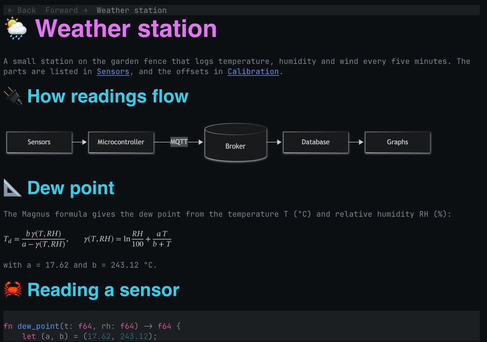
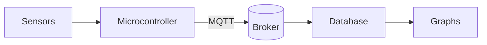
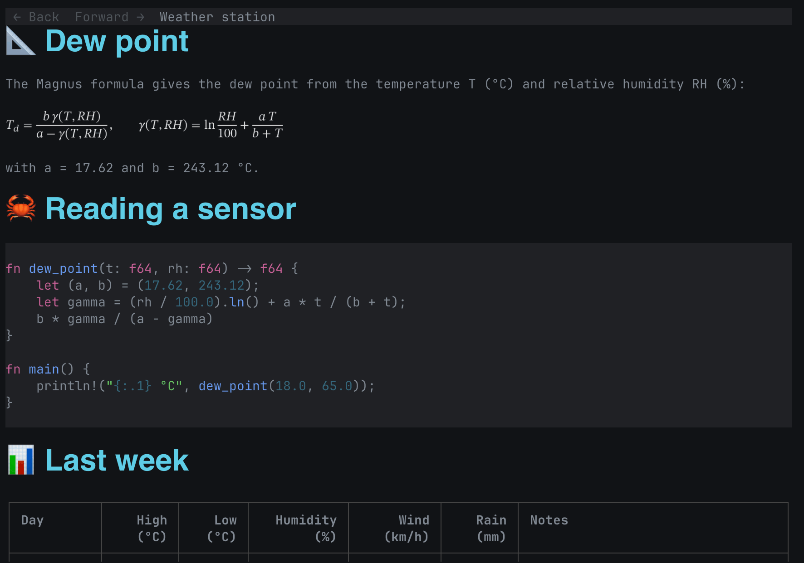
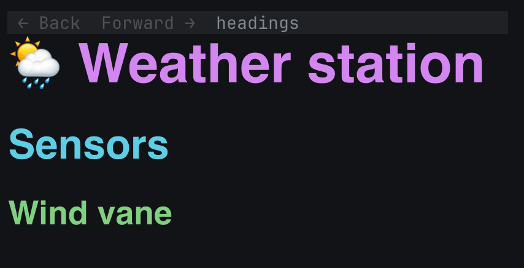
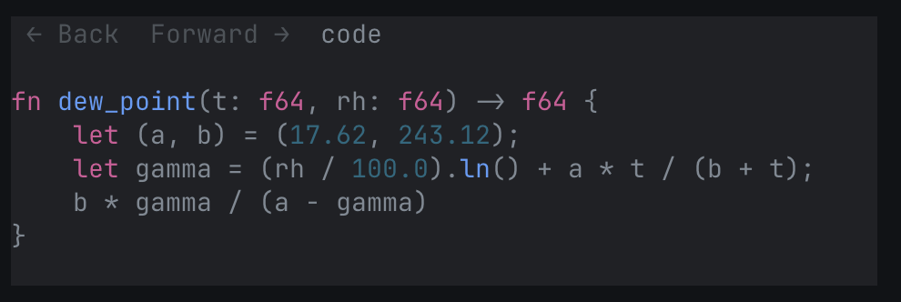
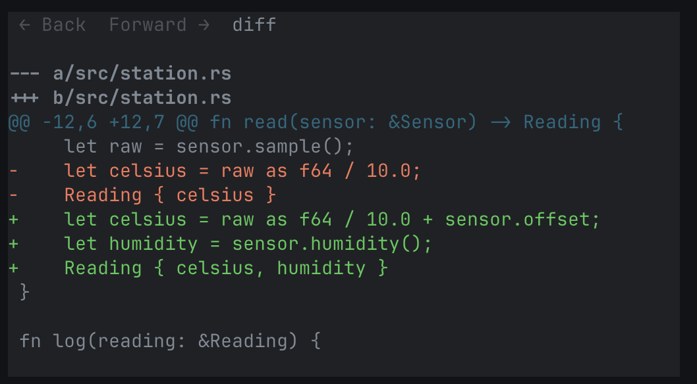
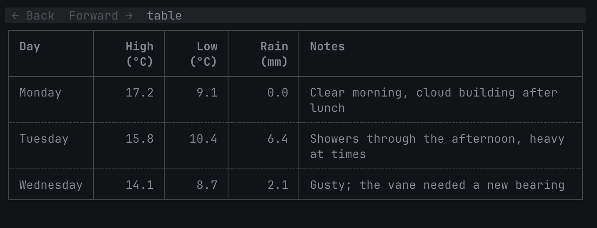
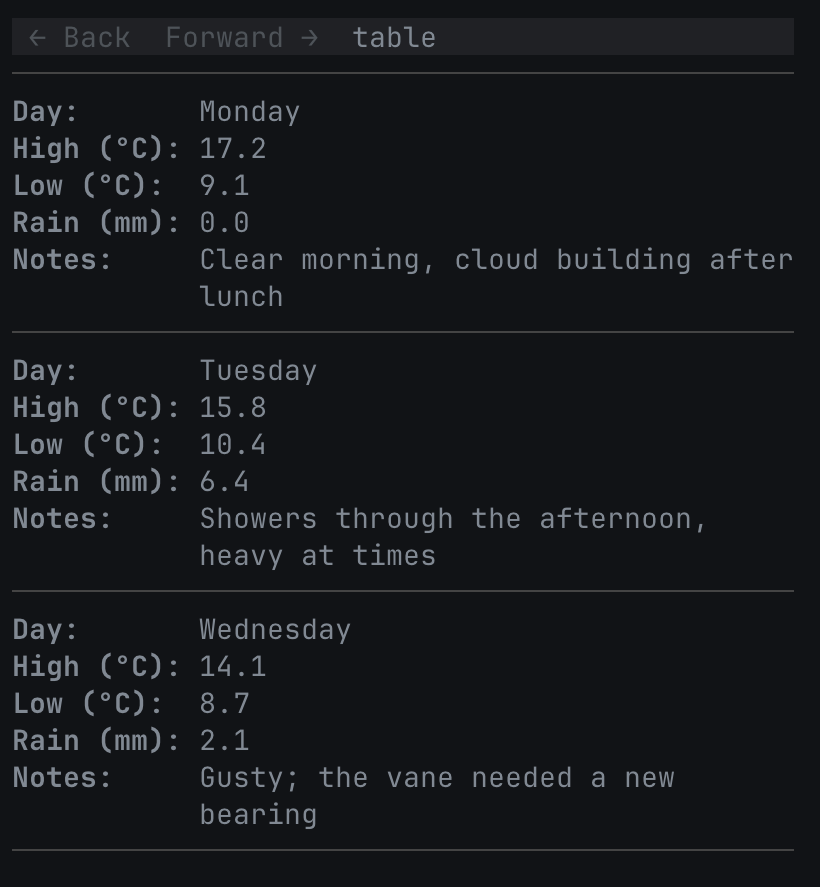
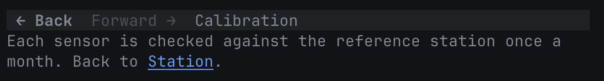

# smd

A sexy markdown reader for the terminal that draws mermaid diagrams, maths and headings as images, and keeps the rest as text you can select.



## Features

- **Diagrams.** A ` ```mermaid ` code block is drawn as an image, by [merman](https://github.com/Latias94/merman).
- **Maths.** Display maths (`$$ ... $$` on its own, or a ` ```math ` block) is drawn as an image. Inline maths stays as text.
- **Headings.** Headings are drawn larger for higher levels. In a terminal with kitty's [text sizing protocol](https://sw.kovidgoyal.net/kitty/text-sizing-protocol/), such as kitty 0.40 or later, they are text the terminal draws larger, so you can select them and follow their links. Elsewhere they are images in a real font, including colour emoji.
- **Images.** A paragraph that holds only a PNG, GIF (first frame), JPEG or SVG, such as `` or an HTML ``, is shown as the image. Local images are read from the markdown file's folder. Images from the web are fetched only when you turn them on (see [Images from the web](#images-from-the-web)).
- **Code blocks.** Code is coloured by the language named on its fence, such as `rust` or `diff`, in the terminal's own colours, on a panel a little lighter than the background (darker on a light one).
- **Tables.** A table wider than the pane wraps its cells. A table with too many columns to wrap well is shown as one card per row, with a `Header: value` line for each cell.
- **Links and notes.** Follow links with the keyboard or the mouse, with a back and forward toolbar. Links to other notes open in smd, and Obsidian wiki links work.
- **Obsidian and GitHub syntax.** Callouts and GitHub alerts, which can fold; embedded notes; frontmatter as a panel of properties; `==highlights==`, `#tags` and hidden `%%comments%%`; footnotes; definition lists; and `:emoji:` shortcodes. See [Links and Obsidian notes](#links-and-obsidian-notes).
- **HTML.** The common HTML in READMEs is read: `<br>`, `<kbd>`, `<sub>`, `<sup>`, `<b>`, `<i>`, `<a href>`, ``, and `<details>`, which folds. Comments are hidden. Other HTML is shown as dim source.
- **Punctuation.** Straight quotes, `--`, `---` and `...` are drawn as curly quotes, en and em dashes and an ellipsis, except in code.
- **Live reload.** smd reloads the file when it changes on disk.

## Screenshots

### Diagrams

A mermaid code block is drawn as an image.

````markdown

````


### Maths

Display maths between `$$` lines is drawn as an image.

```markdown
$$
T_d = \frac{b\,\gamma(T, RH)}{a - \gamma(T, RH)},
\qquad
\gamma(T, RH) = \ln\frac{RH}{100} + \frac{a\,T}{b + T}
$$
```



### Headings

Headings are drawn in a larger font, with a colour for each level, and emoji in colour. This screenshot shows them drawn as images; in kitty they are larger text instead.

```markdown
# 🌦️ Weather station

## Sensors

### Wind vane
```



### Code

A fenced code block is coloured by its language, on a panel.

````markdown
```rust
fn dew_point(t: f64, rh: f64) -> f64 {
    let (a, b) = (17.62, 243.12);
    let gamma = (rh / 100.0).ln() + a * t / (b + t);
    b * gamma / (a - gamma)
}
```
````



### Diffs

A `diff` code block shows added lines in green, removed lines in red and hunk headers in cyan.

````markdown
```diff
--- a/src/station.rs
+++ b/src/station.rs
@@ -12,6 +12,7 @@ fn read(sensor: &Sensor) -> Reading {
     let raw = sensor.sample();
-    let celsius = raw as f64 / 10.0;
-    Reading { celsius }
+    let celsius = raw as f64 / 10.0 + sensor.offset;
+    let humidity = sensor.humidity();
+    Reading { celsius, humidity }
 }
 
 fn log(reading: &Reading) {
```
````



### Tables

A table wider than the pane wraps its cells to fit.

```markdown
| Day | High (°C) | Low (°C) | Rain (mm) | Notes |
| --- | ---: | ---: | ---: | --- |
| Monday | 17.2 | 9.1 | 0.0 | Clear morning, cloud building after lunch |
| Tuesday | 15.8 | 10.4 | 6.4 | Showers through the afternoon, heavy at times |
| Wednesday | 14.1 | 8.7 | 2.1 | Gusty; the vane needed a new bearing |
```



In a narrow pane, each row becomes a card.



### Links

Wiki links between notes can be followed: Tab selects a link, Enter follows it, and Back in the toolbar goes back.

In `Station.md`:

```markdown
The offsets are in [[Calibration]].
```

In `Calibration.md`:

```markdown
Each sensor is checked against the reference station once a month. Back to [[Station]].
```



## Terminal support

Images, diagrams, maths and headings need a terminal that supports the [kitty graphics protocol](https://sw.kovidgoyal.net/kitty/graphics-protocol/) with Unicode placeholders. [Ghostty](https://ghostty.org) is the recommended terminal and the one smd is tested in. Other terminals with Unicode-placeholder support should work but have not been tested.

smd asks the terminal what it supports at start-up. In a terminal without kitty graphics, or with `--no-graphics`, images, diagrams and maths are shown as their markdown source, and headings as styled text. Everything else works the same.

smd also asks whether the terminal has the [text sizing protocol](https://sw.kovidgoyal.net/kitty/text-sizing-protocol/), by drawing a space two columns wide and one twice the size and seeing where the cursor ends up. If it does, headings are drawn as larger text rather than images: three times the size for level 1 and twice for levels 2 and 3, smaller in a narrow pane. kitty has it from version 0.40; Ghostty does not yet. `--no-graphics` turns this off too.

When the terminal runs on the same machine as smd, images are passed to it through shared memory, which is faster for large images than sending them through the terminal. Over ssh, or when the terminal cannot read shared memory, they are sent through the terminal as before. smd removes any shared memory the terminal did not read when it quits, crashes, or is stopped with `kill` (SIGTERM or SIGINT) or by its terminal closing (SIGHUP). On those signals it also puts the terminal back as it was. If smd is stuck writing to a terminal that has stopped reading, it removes the shared memory and ends a second later, or at once on a second signal. A third ends it with SIGKILL. Started under `nohup`, smd ignores SIGHUP.

smd is developed on macOS, and its tests run on Linux.

## Install

With Homebrew, on macOS (Apple silicon) or Linux (x86_64 or arm64):

```sh
brew install ryanlewis/tap/smd
```

Or with the install script, which downloads the latest release, checks it against the release's checksums and puts `smd` in `~/.local/bin`:

```sh
curl -fsSL https://raw.githubusercontent.com/ryanlewis/smd/main/install.sh | sh
```

Set `SMD_INSTALL_DIR` to install somewhere else, or `SMD_VERSION` to pick a release, such as `curl -fsSL ... | SMD_VERSION=0.2.0 sh`.

Or download a binary from the [releases page](https://github.com/ryanlewis/smd/releases). The Linux builds need glibc 2.30 or later.

With Cargo, you need Rust 1.99 or later:

```sh
cargo install --git https://github.com/ryanlewis/smd --locked
```

Or build from source:

```sh
git clone https://github.com/ryanlewis/smd
cd smd
cargo build --release --locked
./target/release/smd notes.md
```

### Optional: mermaid-cli

smd draws diagrams itself. To have [mermaid-cli](https://github.com/mermaid-js/mermaid-cli) draw them instead, as a browser would, install it and set `mermaid = "mmdc"` in the config:

```sh
npm install -g @mermaid-js/mermaid-cli
```

With that set and `mmdc` not on your `PATH`, each diagram is shown as its source, with a note saying `mmdc` was not found.

### Fonts

smd does not bundle fonts. It draws headings with fonts from the system: a bold sans-serif font, a monospace font for inline code, and a colour emoji font.

- macOS: Helvetica, Menlo and Apple Color Emoji, which come with the system.
- Linux: DejaVu Sans or Liberation Sans, DejaVu Sans Mono or Liberation Mono, and Noto Color Emoji, from your distribution's packages.

A heading with a character none of the fonts has, or an emoji that needs shaping (a flag, a skin tone, a joined family), is shown as text.

Diagram labels and text in SVG images use Trebuchet MS or Verdana on macOS, and DejaVu Sans or Liberation Sans on Linux; monospace SVG text uses the monospace font above. Text in a script these fonts lack, such as Chinese or Japanese, and emoji are drawn as boxes. With none of the fonts, smd guesses how wide diagram labels are, and long ones may be cut short.

## Usage

```sh
smd [--no-graphics] [--remote-images | --no-remote-images] [--max-width COLS] [FILE]
```

With no file, smd opens the `home` note from the config, unless markdown is piped in. `--remote-images` and `--no-remote-images` turn [images from the web](#images-from-the-web) on or off for one run, whatever the config says, and `--max-width` sets [`max_width`](#config) for one run. `smd --help` lists the options and the main keys.

smd also reads markdown piped into it, or from stdin when the file is `-` (for a file named `-`, write `./-`):

```sh
gh pr view --json body -q .body | smd
```

If the command feeding smd is slow to start sending, smd shows `reading stdin…` while it waits. Ctrl-C then stops smd and clears the line. Keys and the mouse then come from the terminal. A document read from stdin is not reloaded and its checkboxes cannot be ticked. Its relative links and images are read from the current directory, and the toolbar calls it `stdin`.

### Keys

| Key | Action |
| --- | --- |
| `j`, `k`, Up, Down | Scroll a line |
| Space, PgDn, PgUp, Ctrl-F, Ctrl-B | Scroll a page |
| Ctrl-D, Ctrl-U | Scroll half a page |
| `g`, `G`, Home, End | Go to the top or bottom |
| Tab, Shift-Tab | Select the next or previous link, checkbox or folding title |
| Enter | Follow the selected link, tick or untick the selected checkbox, or fold or unfold the selected title |
| `x` | Tick or untick the selected checkbox |
| Backspace, `H`, Alt-Left | Go back |
| `L`, Alt-Right | Go forward |
| `/` | Search the note: type a term, then Enter to go to the first match from the top of the screen |
| `n`, `N` | Go to the next or previous match, going round at the end |
| `r` | Reload the file |
| `?` | Show the help page |
| `q`, Esc, Ctrl-C | Quit |

Type a number before a key to repeat it: `5j` scrolls five lines and `3` Ctrl-D three half pages. With `g` or `G`, the number is a line to go to: `42G` puts line 42 at the top. A line is a row of the note as smd draws it, counting from 1 at the top, so a long paragraph wrapped over three rows is three lines, and the count changes with the width of the pane. The number shows on the bottom row as you type it, and Esc drops it.

The bottom row shows which page of the note is in view, as `page 3/10`: the page the top line is on, or the last page once the end of the note is in view. When something fails, such as a link to a note that cannot be found or a file that cannot be read, the bottom row says so until the next key.

The keys can be changed in the [config](#config).

`?` opens a help page drawn by smd: a table of every action and the keys bound to it now, including any changed in the config, with short notes on moving around, search, links, tasks and reloading, and where the config file is. It is a note like any other, so it scrolls and can be searched, and Back returns to where you were. It has no file, so it cannot be reloaded.

### Search

Press `/` and type a term. Matches are marked as you type, and the bottom row says how many there are. Enter goes to the first match from the top of the screen; `n` and `N` go to the next and previous match, going round at the end and saying so. A number before them steps that many matches, so `3n` goes three on. The match you are on stays the one you are on when the note is laid out again, such as when images load or the window is resized, and if it was on screen it stays on screen. Esc while typing gives the search up, and Esc after it clears the marks (the next Esc quits). The search ignores case unless the term has a capital letter in it. It looks at the text as drawn, code blocks and table cells included, not the markdown source, and a heading drawn as an image is found by its text. A term that wraps onto the next line is still found, and marked on both lines; so is a line of code, or other text shown as written, that is too long for the pane and broken at its edge. Otherwise lines of code and table cells are searched one line at a time.

### Mouse

Click a link to follow it, click a checkbox to tick or untick it, click a callout's or `<details>` title to fold or unfold it, click the toolbar's Back and Forward buttons, and scroll with the wheel. While smd has the mouse, dragging does not select text; most terminals let you select with Option (macOS) or Shift held.

With `mouse = false` in the config, smd leaves the mouse to the terminal and marks links as terminal hyperlinks (OSC 8) instead, so the terminal opens them: a web link in the browser, and a note in whatever app opens `.md` files.

### Tasks

A task list item, `- [ ] buy bread`, can be ticked from smd: select its checkbox with Tab and press Enter or `x`, or click it. smd changes the one character between the brackets in the file, in place, and leaves the rest of the file as it was. If the file changed on disk since smd last read it, nothing is written and smd shows the new version instead, so you can try again.

Checkboxes in a file smd cannot write to are shown but passed over by Tab and clicks. Set `tasks = "read_only"` in the config to do the same everywhere.

### Links and Obsidian notes


The toolbar on the top row has Back and Forward buttons, dimmed when there is nowhere to go, and the name of the note. Following a link to another note opens it in smd. A link to a heading in the same note scrolls to it, and Back returns to where you were. Web links and files smd does not show (such as a PDF) are opened with the system's opener, `open` or `xdg-open`.

Obsidian wiki links work: `[[Note]]`, `[[folder/Note|text]]`, `[[Note#Heading]]` and `[[#Heading]]`. smd finds the vault by looking up from the file for a folder with a `.obsidian` folder in it, and looks up a note by name anywhere in the vault, as Obsidian does. A note outside a vault looks in its own folder and the folders below it. An embedded image, `![[diagram.png]]`, is shown like any other image.

An embedded note, `![[Note]]`, on a line of its own, shows that note's content in a frame, under the note's name, which links to it. `![[Note#Heading]]` shows only that heading's section, and `![[Note#^block]]` shows the whole note. The embedded note's frontmatter is left out. Links inside an embed lead where they would from the embedded note, and its tasks cannot be ticked. An embed in the middle of a sentence, one that cannot be found, a loop, or one nested more than three deep is shown as a link.

A quote that starts with a callout or GitHub alert type, such as `> [!note]` or `> [!WARNING] Title`, is drawn as a callout: a coloured bar, a title line with a small mark, then the body. An unknown type is drawn as a note, and with no title the type's name is used. Put `-` after the type, `> [!faq]-`, to start it folded shut, or `+` to start it open; then select the title with Tab and press Enter, or click it, to fold or unfold it. An HTML `<details>` block folds the same way, with its `<summary>` as the title, and starts shut unless it has the `open` attribute. In an embedded note, these are always shown open.

Frontmatter at the top of a note is shown as a small dimmed panel, one `key  value` row per top-level key. Lists are joined with commas, and links in a value can be followed. Frontmatter that is not simple `key: value` lines, and TOML `+++` frontmatter, is shown as its raw lines, dimmed.

`==text==` is highlighted. Tags such as `#tag` and `#nested/tag` are shown in colour; `#123` and a `#` in the middle of a word are not tags. `%%comments%%` are hidden, inline or over several lines. None of these are read inside code, and inside tables they are shown as written.

A footnote reference, `[^note]`, is shown as a numbered link, `[1]`, numbered in order of first use. The footnotes are listed at the end of the note after a rule, each with a ↩ link back to where it was first used. Back returns to where you were. A reference with no footnote stays as plain text.

### Images from the web

smd shows images from the web (http and https) only when `remote_images = true` is in the config or `--remote-images` is on the command line. It is off by default, and with it off smd fetches nothing. Images are fetched in the background, with a 10-second timeout and a 10 MB limit, and kept for a day in `~/.cache/smd/images` (or `$XDG_CACHE_HOME/smd/images`; `~/Library/Caches/smd/images` on macOS). If a cached image is older than a day and cannot be fetched again, the old copy is shown. An image that cannot be fetched shows its alt text. An SVG from the web cannot load local files or other URLs.

### Reloading

smd reloads the file when it changes on disk, including when an editor saves by renaming a new file over it. Press `r` to reload it by hand. If the file is deleted, smd keeps showing the last version and says so on the bottom row.

## Config

smd reads `~/.config/smd/config.toml` (or `$XDG_CONFIG_HOME/smd/config.toml`) if there is one. Every setting is optional:

```toml
# Opened when smd is run with no file, so `smd` alone opens your notes.
home = "~/notes/HOME.md"

# What following a web link does: "open" (the default), "copy" to copy it
# to the clipboard through the terminal, or "ignore".
web_links = "open"

# The colour code blocks are drawn on when the terminal does not say what
# its background is. Without it, they are indented instead.
code_background = "#20242a"

# Whether smd takes the mouse, to follow clicked links and scroll with the
# wheel (the default). With false, links are hyperlinks the terminal opens.
mouse = true

# Whether task checkboxes can be ticked: "toggle" (the default), or
# "read_only" so smd never writes to your notes.
tasks = "toggle"

# Whether images from the web (http and https) are fetched and shown.
# Off by default, so smd fetches nothing. `--remote-images` and
# `--no-remote-images` override it for one run.
remote_images = false

# What draws mermaid diagrams: "builtin" (the default), or "mmdc" for
# mermaid-cli, which starts a headless browser for each one.
mermaid = "builtin"

# The widest the text gets, in columns, so lines stay easy to read in a
# wide window. Without it (the default), the text fills the window.
# Code blocks, tables, images and headings keep to it too.
# `--max-width` overrides it for one run.
max_width = 100

# Where the text sits when the window is wider than max_width: "centre"
# (the default) or "left".
align = "centre"

# How headings are drawn: "auto" (the default) for larger text when the
# terminal can draw it and images when not, "image" for images always, or
# "text" for text always, larger when the terminal can draw it.
headings = "auto"

# Keys for each action. Naming an action replaces its default keys.
[keys]
next_link = ["tab", "n"]
back = ["backspace", "h"]
```

`code_background` is also used with `--no-graphics`.

The actions and their default keys:

| Action | Default keys |
| --- | --- |
| `quit` | `q`, `esc`, `ctrl-c` |
| `down`, `up` | `j`, `down`; `k`, `up` |
| `half_down`, `half_up` | `ctrl-d`; `ctrl-u` |
| `page_down`, `page_up` | `space`, `pagedown`, `ctrl-f`; `pageup`, `ctrl-b` |
| `top`, `bottom` | `g`, `home`; `G`, `end` |
| `next_link`, `prev_link` | `tab`; `shift-tab` |
| `follow` | `enter` (also ticks a selected checkbox, or folds a selected title) |
| `toggle` | `x` |
| `back`, `forward` | `backspace`, `H`, `alt-left`; `L`, `alt-right` |
| `search` | `/` |
| `next_match`, `prev_match` | `n`; `N` |
| `reload` | `r` |
| `help` | `?` |

A key is a character (`j`, `G`, `?`), or a name: `enter`, `tab`, `shift-tab`, `backspace`, `esc`, `space`, `up`, `down`, `left`, `right`, `home`, `end`, `pageup`, `pagedown`, `delete`, `insert` or `f1` to `f24`. Put `ctrl-` or `alt-` in front for a modifier. A digit bound to an action is no longer part of a number typed before a key. With `ctrl-`, the letters `a` to `z` ignore case, so `ctrl-o` and `ctrl-O` are the same key. smd stops with an error that names the problem if the file has a mistake in it, such as an unknown setting or one key set for two actions.

## Limitations

- Links in headings drawn as images cannot be selected or clicked. Headings are drawn as larger text, with links that work, only in terminals with the text sizing protocol. Ghostty does not have it yet, so it shows headings as images; set `headings = "text"` for plain text headings with working links.
- Only the first frame of a GIF is shown.
- SVGs are drawn by resvg, which covers most of SVG but not all of CSS. Text in an SVG is set in the diagram fonts (see [Fonts](#fonts)), whatever font it names.
- Diagrams are drawn by merman, which follows mermaid closely but not exactly: a diagram may be laid out a little differently from mermaid's own, and a few that mermaid rejects are drawn. Set `mermaid = "mmdc"` to use mermaid-cli.
- Diagram labels in Chinese, Japanese and other scripts outside the diagram font, and emoji in labels, are drawn as boxes.

## Licence

Licensed under either of

- Apache License, Version 2.0 ([LICENSE-APACHE](LICENSE-APACHE))
- MIT license ([LICENSE-MIT](LICENSE-MIT))

at your option.

Unless you explicitly state otherwise, any contribution intentionally submitted for inclusion in this work by you, as defined in the Apache-2.0 license, shall be dual licensed as above, without any additional terms.
