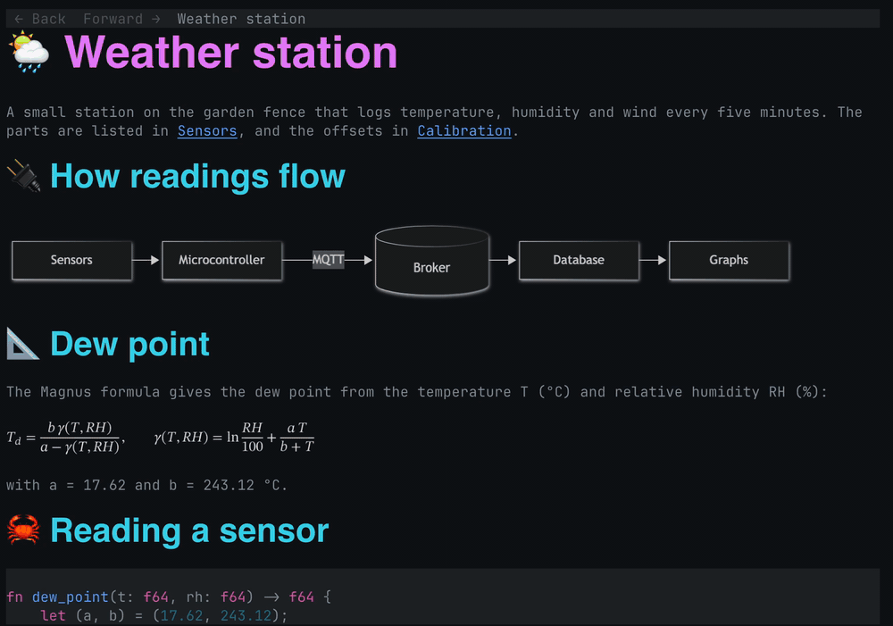
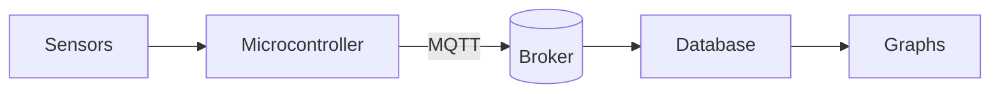
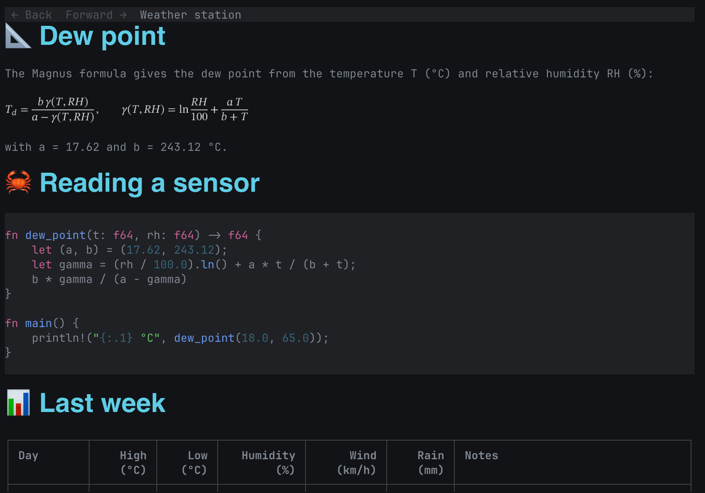
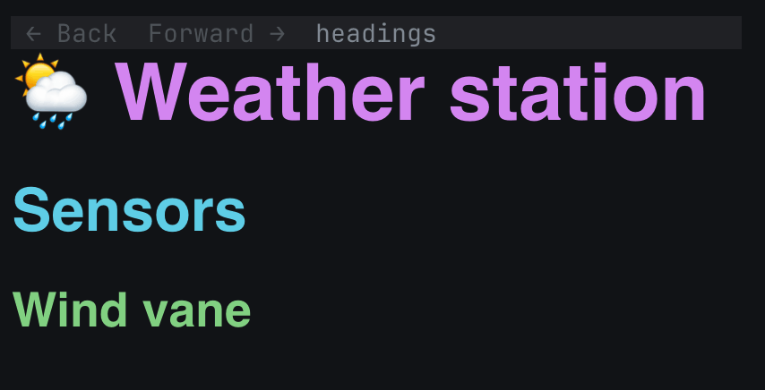
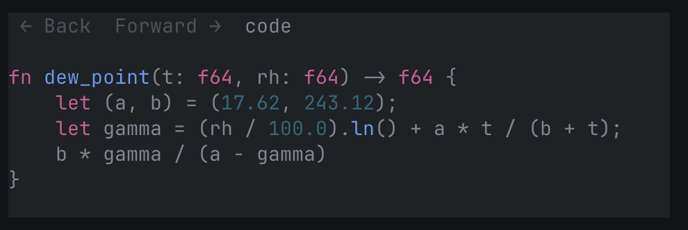
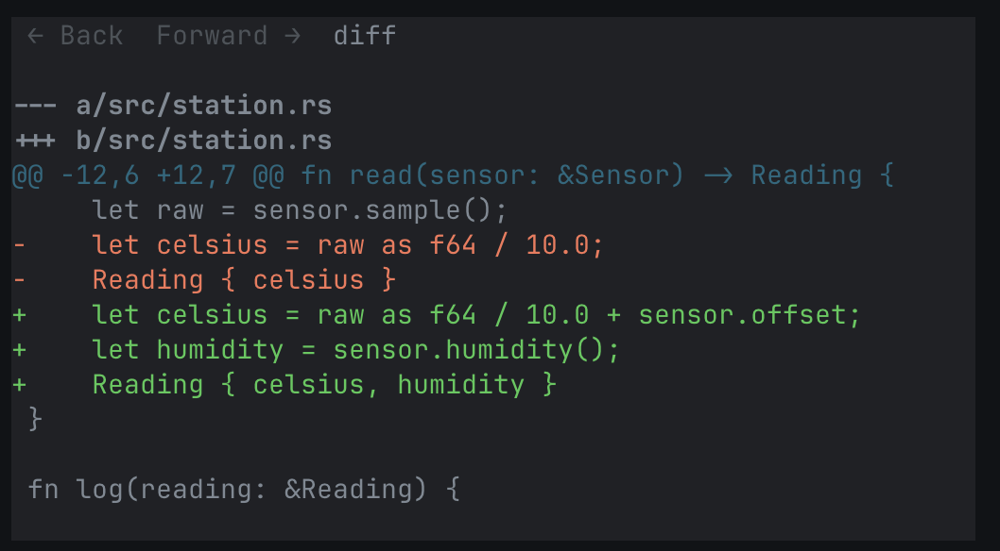
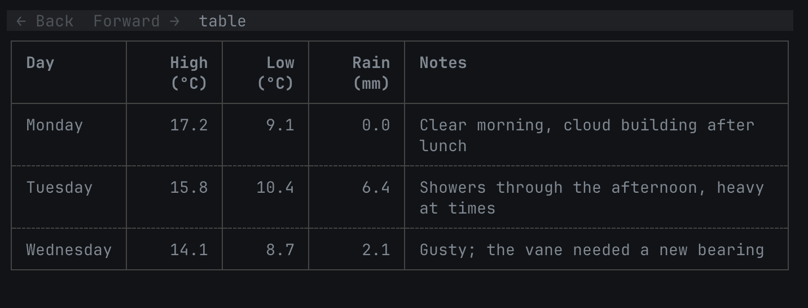
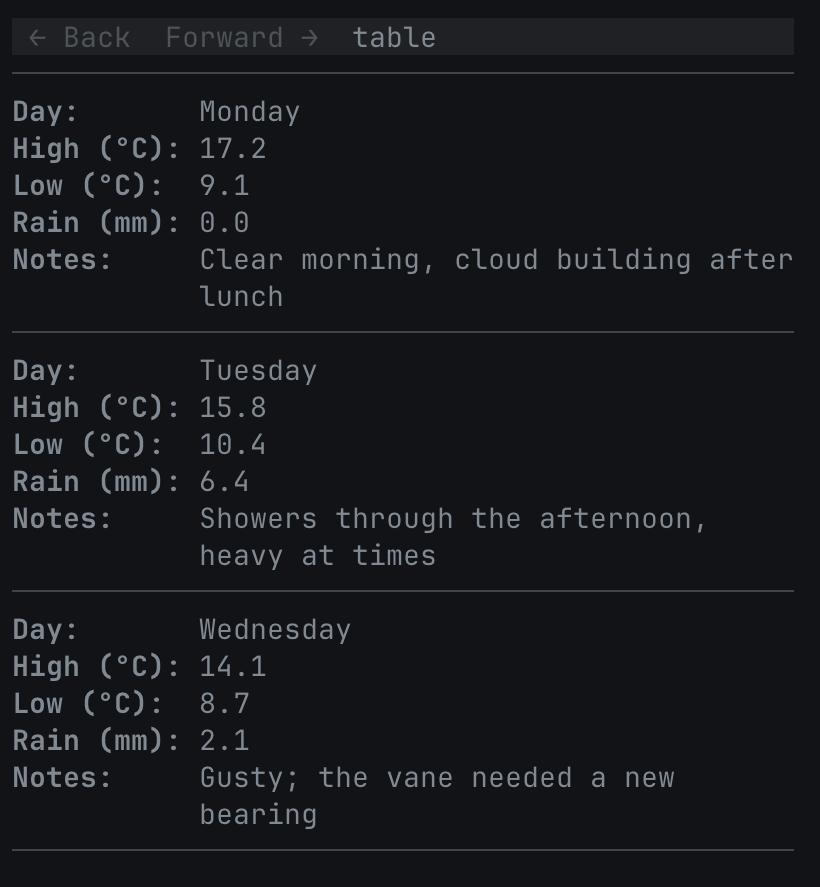
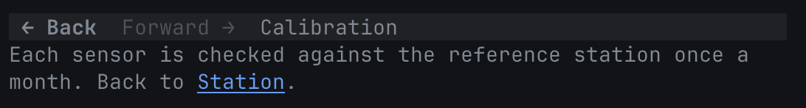

# smd

A sexy markdown reader for the terminal that draws mermaid diagrams, maths and headings as images, and keeps the rest as text you can select.



## Features

- **Diagrams.** A ` ```mermaid ` code block is drawn as an image by [mermaid-cli](https://github.com/mermaid-js/mermaid-cli) (`mmdc`). Diagrams are cached on disk, so a file opens fast the second time.
- **Maths.** Display maths (`$$ ... $$` on its own, or a ` ```math ` block) is drawn as an image in pure Rust, with no TeX install. Inline maths stays as text.
- **Headings.** Headings are drawn as images in a real font, larger for higher levels, including colour emoji.
- **Images.** A paragraph that holds only a local PNG, GIF (first frame) or JPEG, such as ``, is shown as the image, read from the markdown file's folder.
- **Code blocks.** Code is coloured by the language named on its fence, such as `rust` or `diff`, in the terminal's own colours, on a panel a little lighter than the background (darker on a light one).
- **Tables.** A table wider than the pane wraps its cells. A table with too many columns to wrap well is shown as one card per row, with a `Header: value` line for each cell.
- **Links and notes.** Follow links with the keyboard or the mouse, with a back and forward toolbar. Links to other notes open in smd, and Obsidian wiki links work.
- **Live reload.** smd reloads the file when it changes on disk.

## Screenshots

### Diagrams

A mermaid code block is drawn as an image.

````markdown

````


### Maths

Display maths between `$$` lines is drawn as an image.

```markdown
$$
T_d = \frac{b\,\gamma(T, RH)}{a - \gamma(T, RH)},
\qquad
\gamma(T, RH) = \ln\frac{RH}{100} + \frac{a\,T}{b + T}
$$
```



### Headings

Headings are drawn as images in a larger font, with a colour for each level, and emoji in colour.

```markdown
# 🌦️ Weather station

## Sensors

### Wind vane
```



### Code

A fenced code block is coloured by its language, on a panel.

````markdown
```rust
fn dew_point(t: f64, rh: f64) -> f64 {
    let (a, b) = (17.62, 243.12);
    let gamma = (rh / 100.0).ln() + a * t / (b + t);
    b * gamma / (a - gamma)
}
```
````



### Diffs

A `diff` code block shows added lines in green, removed lines in red and hunk headers in cyan.

````markdown
```diff
--- a/src/station.rs
+++ b/src/station.rs
@@ -12,6 +12,7 @@ fn read(sensor: &Sensor) -> Reading {
     let raw = sensor.sample();
-    let celsius = raw as f64 / 10.0;
-    Reading { celsius }
+    let celsius = raw as f64 / 10.0 + sensor.offset;
+    let humidity = sensor.humidity();
+    Reading { celsius, humidity }
 }
 
 fn log(reading: &Reading) {
```
````



### Tables

A table wider than the pane wraps its cells to fit.

```markdown
| Day | High (°C) | Low (°C) | Rain (mm) | Notes |
| --- | ---: | ---: | ---: | --- |
| Monday | 17.2 | 9.1 | 0.0 | Clear morning, cloud building after lunch |
| Tuesday | 15.8 | 10.4 | 6.4 | Showers through the afternoon, heavy at times |
| Wednesday | 14.1 | 8.7 | 2.1 | Gusty; the vane needed a new bearing |
```



In a narrow pane, each row becomes a card.



### Links

Wiki links between notes can be followed: Tab selects a link, Enter follows it, and Back in the toolbar goes back.

In `Station.md`:

```markdown
The offsets are in [[Calibration]].
```

In `Calibration.md`:

```markdown
Each sensor is checked against the reference station once a month. Back to [[Station]].
```



## Terminal support

Images, diagrams, maths and headings need a terminal that supports the [kitty graphics protocol](https://sw.kovidgoyal.net/kitty/graphics-protocol/) with Unicode placeholders. [Ghostty](https://ghostty.org) is the recommended terminal and the one smd is tested in. Other terminals with Unicode-placeholder support should work but have not been tested.

smd asks the terminal what it supports at start-up. In a terminal without kitty graphics, or with `--no-graphics`, images, diagrams and maths are shown as their markdown source, and headings as styled text. Everything else works the same.

smd is developed on macOS, and its tests run on Linux.

## Install

With Homebrew, on macOS (Apple silicon) or Linux (x86_64 or arm64):

```sh
brew install ryanlewis/tap/smd
```

Or download a binary from the [releases page](https://github.com/ryanlewis/smd/releases). The Linux builds need glibc 2.30 or later.

With Cargo, you need Rust 1.99 or later:

```sh
cargo install --git https://github.com/ryanlewis/smd --locked
```

Or build from source:

```sh
git clone https://github.com/ryanlewis/smd
cd smd
cargo build --release --locked
./target/release/smd notes.md
```

### Optional: mermaid-cli

Diagrams need `mmdc` on your `PATH`:

```sh
npm install -g @mermaid-js/mermaid-cli
```

Without it, each diagram is shown as its source, with a note saying `mmdc` was not found.

### Fonts

smd does not bundle fonts. It draws headings with fonts from the system: a bold sans-serif font, a monospace font for inline code, and a colour emoji font.

- macOS: Helvetica, Menlo and Apple Color Emoji, which come with the system.
- Linux: DejaVu Sans or Liberation Sans, DejaVu Sans Mono or Liberation Mono, and Noto Color Emoji, from your distribution's packages.

A heading with a character none of the fonts has, or an emoji that needs shaping (a flag, a skin tone, a joined family), is shown as text.

## Usage

```sh
smd [--no-graphics] [FILE]
```

With no file, smd opens the `home` note from the config. `smd --help` lists the options and the main keys.

### Keys

| Key | Action |
| --- | --- |
| `j`, `k`, Up, Down | Scroll a line |
| Space, PgDn, PgUp, Ctrl-F, Ctrl-B | Scroll a page |
| Ctrl-D, Ctrl-U | Scroll half a page |
| `g`, `G`, Home, End | Go to the top or bottom |
| Tab, Shift-Tab | Select the next or previous link |
| Enter | Follow the selected link |
| Backspace, `H`, Alt-Left | Go back |
| `L`, Alt-Right | Go forward |
| `q`, Esc, Ctrl-C | Quit |

The keys can be changed in the [config](#config).

### Mouse

Click a link to follow it, click the toolbar's Back and Forward buttons, and scroll with the wheel. While smd has the mouse, dragging does not select text; most terminals let you select with Option (macOS) or Shift held.

With `mouse = false` in the config, smd leaves the mouse to the terminal and marks links as terminal hyperlinks (OSC 8) instead, so the terminal opens them: a web link in the browser, and a note in whatever app opens `.md` files.

### Links and Obsidian notes


The toolbar on the top row has Back and Forward buttons, dimmed when there is nowhere to go, and the name of the note. Following a link to another note opens it in smd. Web links and files smd does not show (such as a PDF) are opened with the system's opener, `open` or `xdg-open`.

Obsidian wiki links work: `[[Note]]`, `[[folder/Note|text]]`, `[[Note#Heading]]` and `[[#Heading]]`. smd finds the vault by looking up from the file for a folder with a `.obsidian` folder in it, and looks up a note by name anywhere in the vault, as Obsidian does. A note outside a vault looks in its own folder and the folders below it. An embedded image, `![[diagram.png]]`, is shown like any other image. An embedded note, `![[Note]]`, is shown as a link to it.

### Reloading

smd reloads the file when it changes on disk, including when an editor saves by renaming a new file over it. If the file is deleted, smd keeps showing the last version and says so on the bottom row.

## Config

smd reads `~/.config/smd/config.toml` (or `$XDG_CONFIG_HOME/smd/config.toml`) if there is one. Every setting is optional:

```toml
# Opened when smd is run with no file, so `smd` alone opens your notes.
home = "~/notes/HOME.md"

# What following a web link does: "open" (the default), "copy" to copy it
# to the clipboard through the terminal, or "ignore".
web_links = "open"

# The colour code blocks are drawn on when the terminal does not say what
# its background is. Without it, they are indented instead.
code_background = "#20242a"

# Whether smd takes the mouse, to follow clicked links and scroll with the
# wheel (the default). With false, links are hyperlinks the terminal opens.
mouse = true

# Keys for each action. Naming an action replaces its default keys.
[keys]
next_link = ["tab", "n"]
back = ["backspace", "h"]
```

`code_background` is also used with `--no-graphics`.

The actions and their default keys:

| Action | Default keys |
| --- | --- |
| `quit` | `q`, `esc`, `ctrl-c` |
| `down`, `up` | `j`, `down`; `k`, `up` |
| `half_down`, `half_up` | `ctrl-d`; `ctrl-u` |
| `page_down`, `page_up` | `space`, `pagedown`, `ctrl-f`; `pageup`, `ctrl-b` |
| `top`, `bottom` | `g`, `home`; `G`, `end` |
| `next_link`, `prev_link` | `tab`; `shift-tab` |
| `follow` | `enter` |
| `back`, `forward` | `backspace`, `H`, `alt-left`; `L`, `alt-right` |

A key is a character (`j`, `G`, `?`), or a name: `enter`, `tab`, `shift-tab`, `backspace`, `esc`, `space`, `up`, `down`, `left`, `right`, `home`, `end`, `pageup`, `pagedown`, `delete`, `insert` or `f1` to `f24`. Put `ctrl-` or `alt-` in front for a modifier. With `ctrl-`, the letters `a` to `z` ignore case, so `ctrl-o` and `ctrl-O` are the same key. smd stops with an error that names the problem if the file has a mistake in it, such as an unknown setting or one key set for two actions.

## Limitations

- Links in headings drawn as images cannot be selected or clicked yet.
- Only the first frame of a GIF is shown.
- Only local images are shown; images from the web are not fetched.
- Each mermaid diagram starts `mmdc`, which starts a browser, so the first open of a file with many diagrams is slow. Later opens use the cache.

## Licence

Licensed under either of

- Apache License, Version 2.0 ([LICENSE-APACHE](LICENSE-APACHE))
- MIT license ([LICENSE-MIT](LICENSE-MIT))

at your option.

Unless you explicitly state otherwise, any contribution intentionally submitted for inclusion in this work by you, as defined in the Apache-2.0 license, shall be dual licensed as above, without any additional terms.
