# 🗺️ Diagrams

The [[Weather station]] drawn as one diagram of each common mermaid type, to see how smd draws them.

## Flowchart

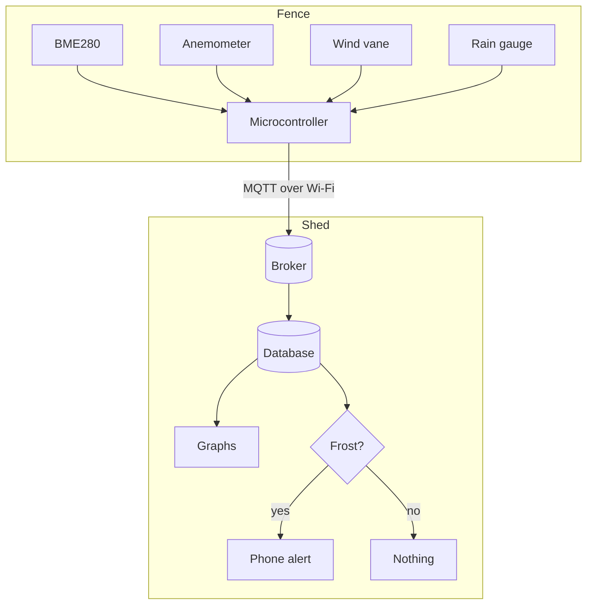

## Sequence

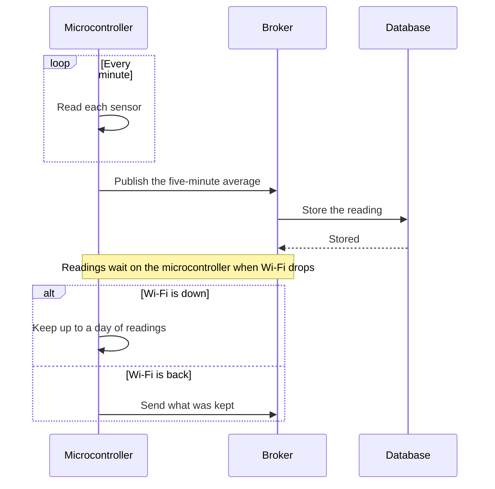

## State

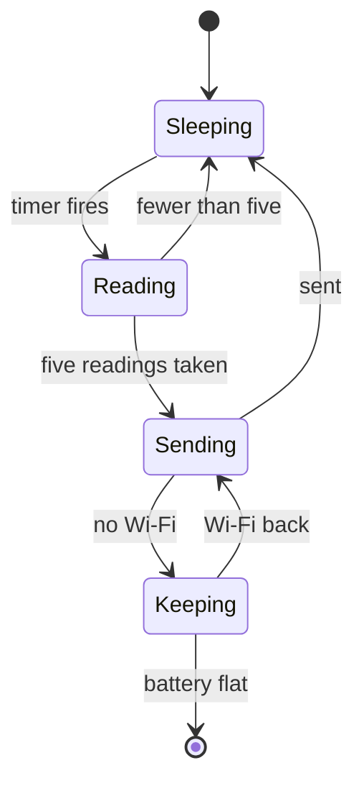

## Class

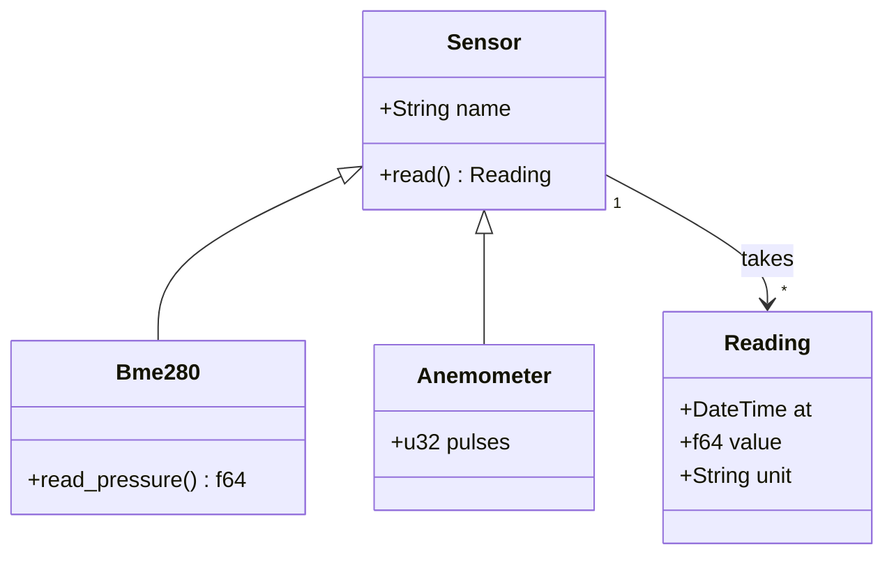

## Entity relationship

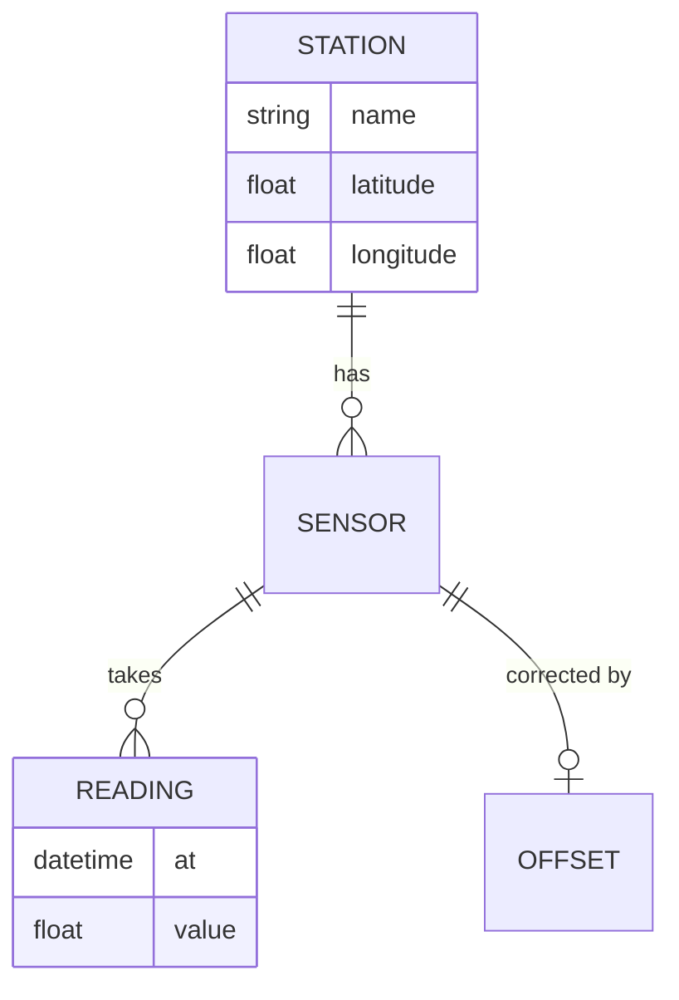

## Gantt

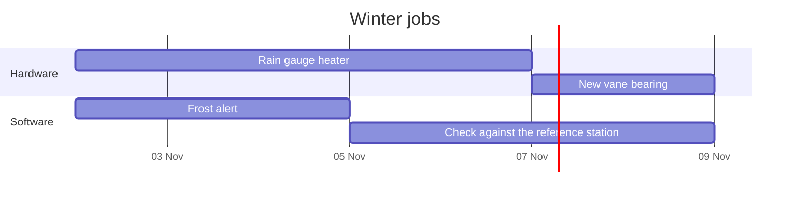

## Pie

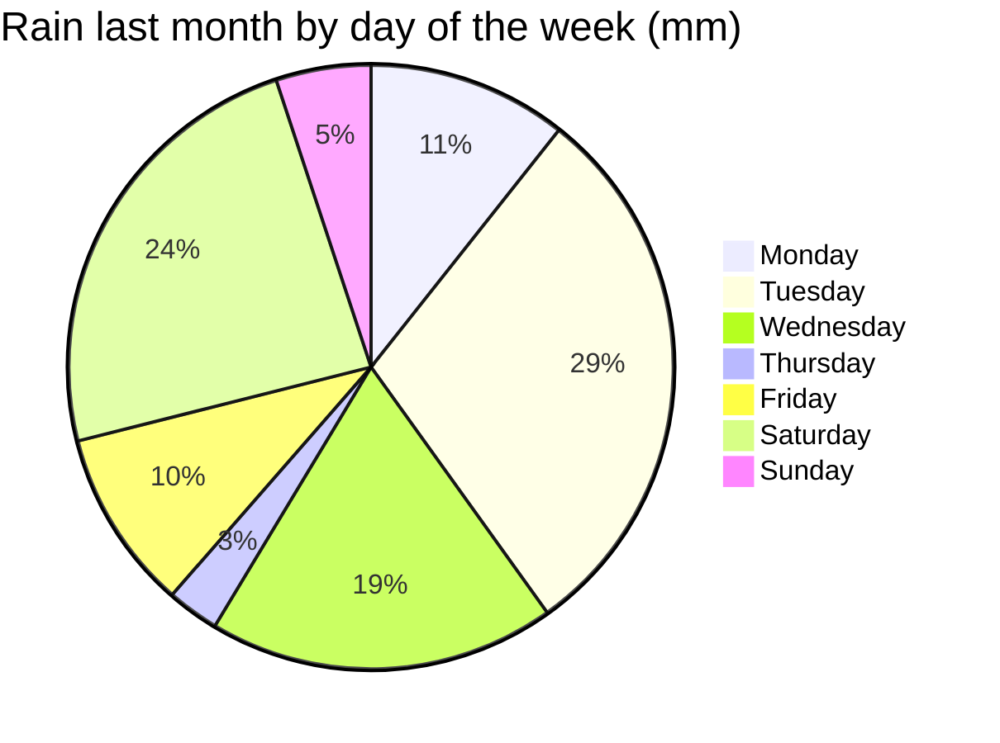

## Mindmap

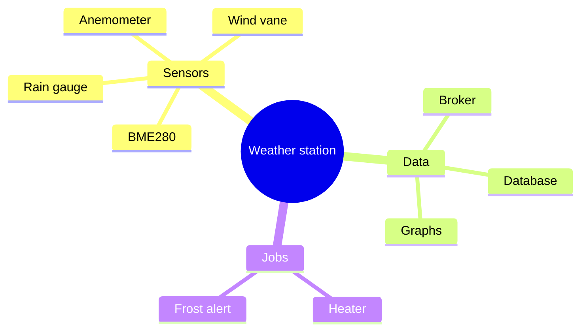

## Timeline

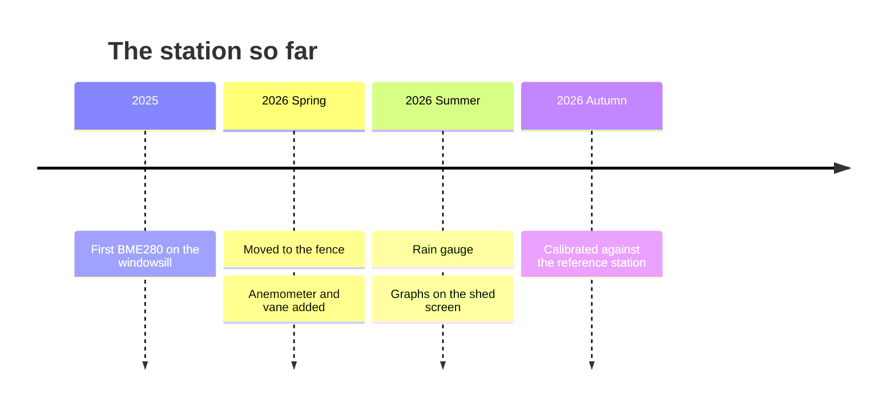

## Git graph

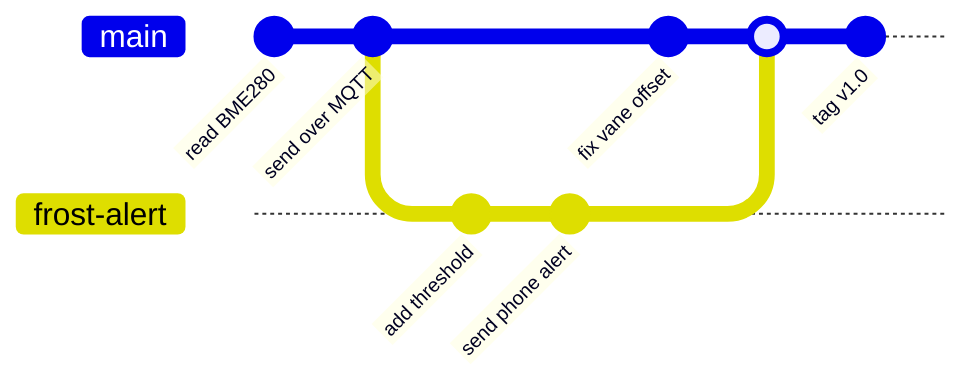

## Quadrant

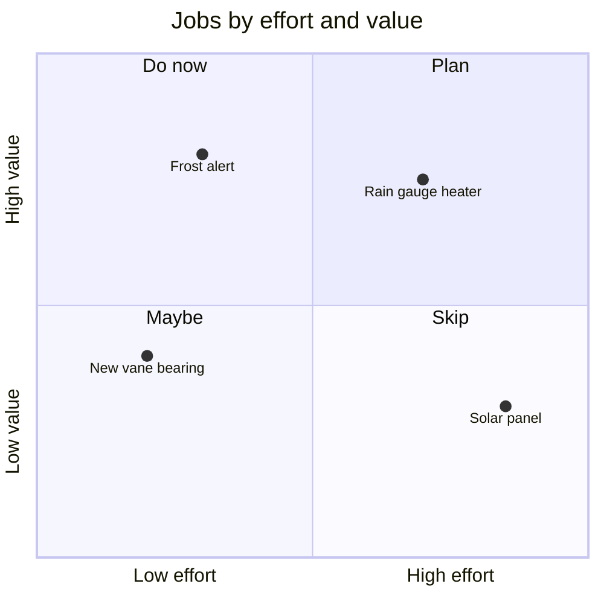

## XY chart

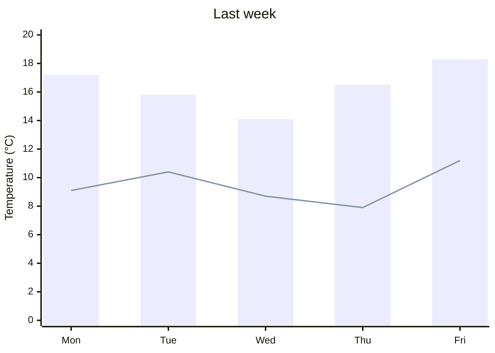
