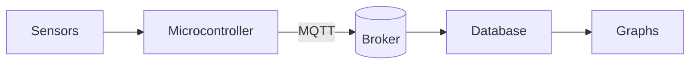

# 🌦️ Weather station

A small station on the garden fence that logs temperature, humidity and wind every five minutes. The parts are listed in [[Sensors]], and the offsets in [[Calibration]].

## 🔌 How readings flow



## 📐 Dew point

The Magnus formula gives the dew point from the temperature T (°C) and relative humidity RH (%):

$$
T_d = \frac{b\,\gamma(T, RH)}{a - \gamma(T, RH)},
\qquad
\gamma(T, RH) = \ln\frac{RH}{100} + \frac{a\,T}{b + T}
$$

with a = 17.62 and b = 243.12 °C.

## 🦀 Reading a sensor

```rust
fn dew_point(t: f64, rh: f64) -> f64 {
    let (a, b) = (17.62, 243.12);
    let gamma = (rh / 100.0).ln() + a * t / (b + t);
    b * gamma / (a - gamma)
}

fn main() {
    println!("{:.1} °C", dew_point(18.0, 65.0));
}
```

## 📊 Last week

| Day | High (°C) | Low (°C) | Humidity (%) | Wind (km/h) | Rain (mm) | Notes |
| --- | ---: | ---: | ---: | ---: | ---: | --- |
| Monday | 17.2 | 9.1 | 71 | 12 | 0.0 | Clear morning, cloud building after lunch |
| Tuesday | 15.8 | 10.4 | 84 | 22 | 6.4 | Showers through the afternoon |
| Wednesday | 14.1 | 8.7 | 79 | 30 | 2.1 | Gusty; the vane needed a new bearing |
| Thursday | 16.5 | 7.9 | 68 | 9 | 0.0 | Calm and dry |
| Friday | 18.3 | 11.2 | 74 | 14 | 0.8 | Light drizzle at dusk |

## 🌀 Pattern of the week


## ✅ To do

- [x] Mount the anemometer higher
- [ ] Add a rain gauge heater for winter
- [ ] Check the readings against [[Calibration#Reference station|the reference station]]

See also: [[Sensors]].
