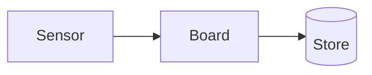
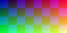

# Screenshot test

A note for the screenshot tests: one of each thing smd draws. Some **bold**,
*italic* and `code` text, and a [link](note.md).

## A diagram



## Maths

$$
\gamma = \ln\frac{RH}{100} + \frac{a\,T}{b + T}
$$

### An image



## Code and a table

```rust
fn dew_point(t: f64, rh: f64) -> f64 {
    let (a, b) = (17.62, 243.12);
    b * (rh / 100.0).ln() / (a - t)
}
```

| Day | High | Rain | Notes |
| --- | ---: | ---: | --- |
| Monday | 17.2 | 0.0 | Clear |
| Tuesday | 15.8 | 6.4 | Showers |
